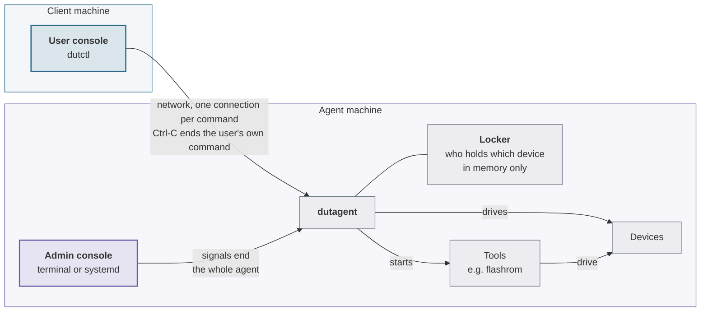
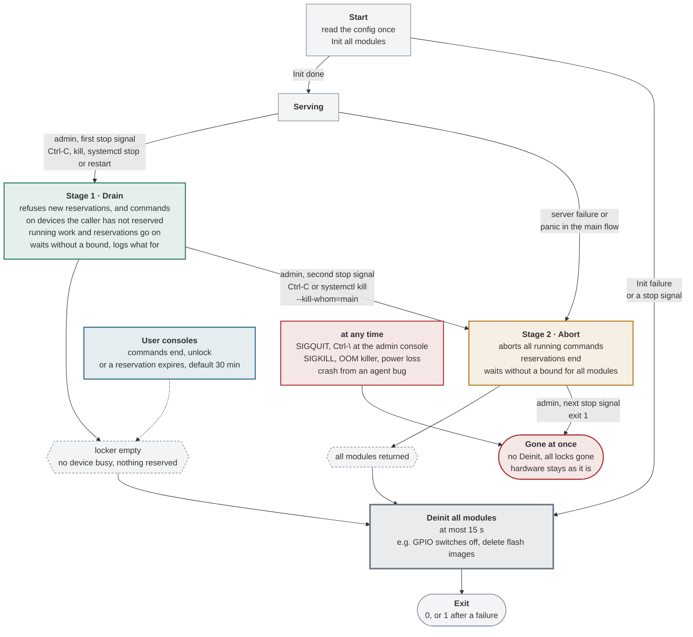

# About the agent's lifecycle

For admins and advanced users: who can end a command or the whole agent, what
happens to the device and its lock, which times apply, and when the modules are
deinitialized. [What ends a command or the agent](./stop-causes.md) lists every
cause; [Stop and restart dutagent](./stop-dutagent.md) shows how an admin does it.

- **User console**: the terminal on the client machine that runs `dutctl`. It
  reaches the agent only over the network and can end at most its own command.
- **Admin console**: a terminal or systemd on the agent machine. Only from here
  can the agent itself be ended, with signals.
- **Stop signal**: `SIGTERM`, `SIGINT` (Ctrl-C) or `SIGHUP`. They count
  together, and each one takes the agent from its stage to the next: the first
  starts stage 1, the next stage 2, and one during stage 2 exits at once. So
  once a failure has started stage 2, the next stop signal exits. The OS may
  merge identical signals sent in a quick burst: send the next one after the
  agent has logged the previous one. An agent started with `SIGINT` or `SIGHUP`
  ignored, as by `nohup` or a script that starts it in the background, keeps
  ignoring them, so it outlives its terminal.
- **Lock**: per device, a Busy hold for each command that runs, and optionally
  a reservation taken with `dutctl <device> lock`. Both live in memory only and
  are gone whenever the agent ends.

## Who can end what

A user ends at most their own command, from their console. Only the admin on
the agent machine ends the agent.

## A command ends

A command ends when its modules have returned, on their own or after an abort.
Its client can abort it, with Ctrl-C, by losing the connection or by breaking
the stream, and so can the agent in stage 2. The abort reaches the module
through its context: a flash tool gets `SIGTERM` and, after 10 s, `SIGKILL`;
other tools get `SIGKILL` at once. The device stays busy until the module has
really returned and its output is delivered, not until the client is gone, so
a client that stops reading keeps it busy too. The user's own reservation
stays, and Deinit never runs at the end of a command. The table under "All
causes" lists every case.

## The agent ends

The three stages, failures at start and while serving, and every way to Deinit.
Failures while serving go through stage 2, so Deinit never runs beside a
running module. Init gets a context that ends after 5 min or with the first
stop signal, but is not cut short: a module whose Init ignores its context
holds the start, and with it the agent, until it returns.

In stage 1, the owner of a reservation may still run commands on that device
and extend the reservation, so a job can run to its end. To end a single
forgotten reservation instead of aborting every command, use
`dutctl <device> unlock force`.

Under a service manager, the unit must leave the stop to dutagent; the example
unit in [packaging/](../packaging/README.md) does, and
[Stop and restart dutagent](./stop-dutagent.md) shows how `systemctl stop`,
`restart` and `kill --kill-whom=main` map to the stages.

## When Deinit runs

Deinit runs:

- after stage 1, once the locker is empty;
- after stage 2, once all modules have returned;
- after a failure or a stop signal during the start;
- after a server failure or a panic in the main flow, through stage 2.

It always runs only once no module runs any more, and for at most 15 s: a
module whose Deinit has not returned by then is left behind. If Deinit fails or
runs out of time, the agent exits with 1 and logs "UNKNOWN STATE".

Deinit never runs at the end of a command, on a stop signal during stage 2 or
`SIGQUIT`, or on `SIGKILL`, the OOM killer, a crash or a power loss. Then only
Init at the next start brings the hardware back to its initial state. What
Deinit does, for example: release GPIO buttons and switch GPIO switches off,
which can switch a device off; delete flash images; close IPMI connections.
