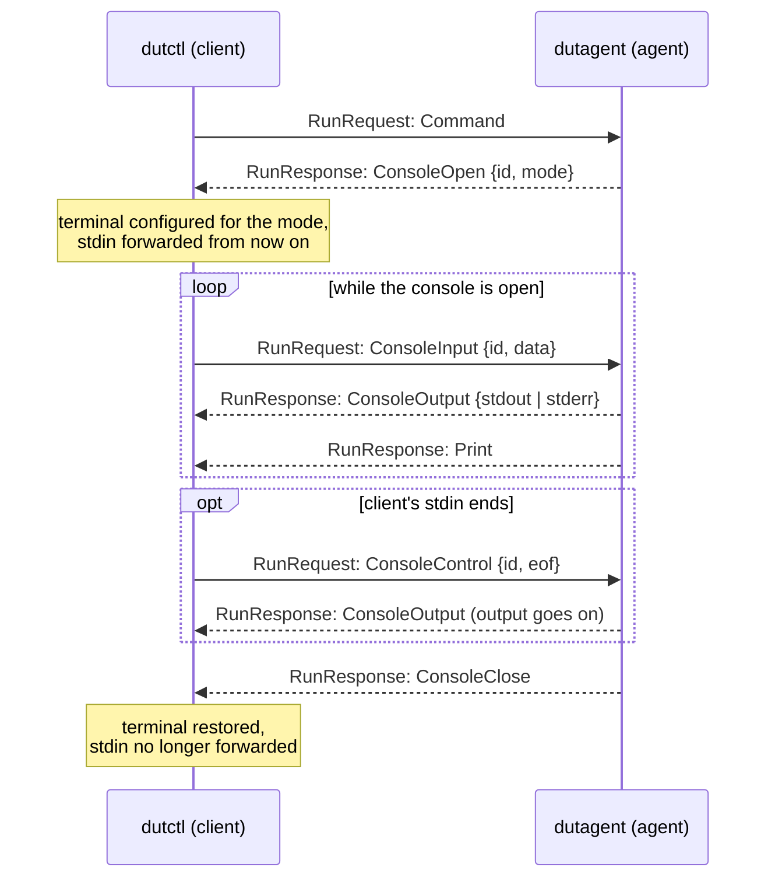

# RPC protocol

The distributed entities of the DUT Control system communicate via Remote Procedure Calls (RPCs), which are defined in
`protobuf/dutctl/v1/dutctl.proto`; agents register with a DUT Server through the experimental relay protocol in
`protobuf/dutctl/relay/v1alpha1/relay.proto`. The communication is always initiated by the client, which issues the
calls of the RPC service to the agent, as [defined](#definitions) below:

1) List, to list the available connected devices
2) Commands, to learn about the available commands of a given device
3) Details, to get the help of a command
4) Lock and Unlock, to reserve a device and to release it
5) Run, to execute a command on a device

While the others are single requests, the Run-RPC is a bidirectional stream, where both the client and the
agent are sending multiple messages until the end of the command execution. According to the protobuf definition, during
a Run-RPC stream, the client and the agent are sending RunRequests and RunResponses, respectively. These messages are
abstractions for different types of messages being sent between client and agent, and the following convention applies:

The first RunRequest sent by the client must always be a Command message. Depending on the module implementation of the
executed command, there are the following scenarios for the further communication during the Run-RPC stream:

**Print**: After the initial RunRequest with a Command message by the client, the agent sends one or many RunResponses
being Print messages. This type of messages is usually good for status updates of basic commands, which do not require
further interaction or input. Print messages may be sent at any time, also while a console is open; the client shows
Print and console output in the order received.

**Console**: A console is how a module and the user interact through the client's standard streams. The agent opens it
with a RunResponse being a ConsoleOpen message, which carries the console's mode (LINE or RAW) and an id that is unique
within the run. From then on until the console ends, the client forwards its standard input to the agent as
ConsoleInput messages marked with that id, and the agent sends the module's standard output and standard error to the
client as ConsoleOutput messages. The payload is opaque: no hop alters it. The console ends with a ConsoleClose message
when the module returns; the end of the stream closes a console that is still open. The client forwards input only
while a console is open and marks it with the console's id; the agent discards input that is not marked for the open
console and never queues it for a console opened later. Input the client had already read when a console closed
reaches the next console, as typeahead does. A module has one console at a time, so a second ConsoleOpen within a run
implies the end of the first console.

When the client's standard input ends (a pipe at its end, Ctrl-D in a line console), the client sends its pending input
and then a ConsoleControl message with an eof event. The module's input then reports end of file, while the console's
output and any file transfers go on; the stream itself stays open until the command ends.

The mode tells the client how the module uses its console, so that the client can configure a terminal accordingly:

- **LINE**: the module reads newline-terminated lines of text. The terminal is left as it is: line editing and local
  echo are done by the terminal, Enter sends the line, and Ctrl-C interrupts the client as usual. This is the mode for
  prompts, question-and-answer interaction and input piped to a process.
- **RAW**: the module consumes bytes as typed and produces bytes for a terminal, as a serial port does. The terminal is
  switched to raw mode: every key, Ctrl-C and Escape included, is sent at once and unchanged, and output is written to
  the terminal as received. Since Ctrl-C now goes to the device, the client keeps a local escape key: `Ctrl-A x` ends
  the session, `Ctrl-A Ctrl-A` sends a literal Ctrl-A, and `Ctrl-A e` toggles a local echo for devices that do not
  echo themselves. The client prints a hint with these keys on standard error when it enters raw mode.

Raw mode is used only when the client's standard input is a terminal and the output format is text. Otherwise, for
example with input piped from a file or in CI, the input is forwarded as it is read, in chunks, with no raw mode
anywhere.

Files move in chunks of up to 1 MiB, so neither side holds a whole file in memory, and other messages pass between two
chunks. A transfer has an ID that the agent assigns, and its chunks are numbered from 0; the last one is marked final. A
run can move several files, one at a time, mixed with Print messages and consoles. Note that while a console is open, a
file transfer waits behind the module's reading of the console input.

**File download to the client**: A module sends a file with `SendFile`. The agent announces the download with a
FileTransferRequest in the download direction, which names the destination path on the client, and then streams the
file as FileChunk messages. The client writes them to a temporary file next to the destination and moves it into place
when the final chunk has arrived, so a broken download leaves the destination as it was. It then confirms the download
with a FileTransferResponse with the status TRANSFER_COMPLETE, and only then does the module's `SendFile` return.

**File upload to the agent**: A module requests a file with `RequestFile`. The agent sends a FileTransferRequest in the
upload direction, which names the path on the client, and the client sends the file as FileChunk messages at once. The
agent writes each chunk to the module's writer before it takes the next, so the flow control of the stream paces the
client. Once the module has the whole file, the agent answers TRANSFER_COMPLETE, and only then does the module's
`RequestFile` return.

No side waits for an answer before it sends a file. The first chunk carries the size of the file, or 0 if the sender
does not know it. Either side ends a transfer it cannot continue with a FileTransferResponse with the status ERROR, and
the sender stops on it. A download that fails this way fails the run on the client. The agent drops a message for a
transfer that has ended, as the client may have sent it before it heard of the end. A chunk out of order, or a message
for a transfer that the agent never started, ends the run with the error code `InvalidArgument`.

> [!IMPORTANT]
> The console and file transfer protocols described here replaced the earlier Console, File and FileRequest messages.
> Before v1.0.0, no compatibility between versions is kept across such a change: update dutctl and dutagent together,
> and do not run mixed versions.

## Definitions

The calls and messages as [dutctl.proto](../protobuf/dutctl/v1/dutctl.proto) defines them:

<!-- embed: protobuf/dutctl/v1/dutctl.proto -->
